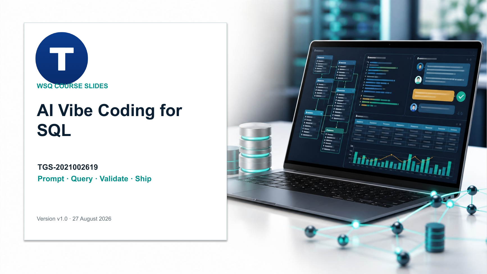

# AI Vibe Coding for SQL



| Course detail | Information |
|---|---|
| Course code | `TGS-2021002619` |
| Programme | WSQ |
| Duration | 1 day · 8 training hours + 1 hour assessment |
| Registration | [View course details and register](https://www.tertiarycourses.com.sg/wsq-ai-vibe-coding-for-sql.html) |
| Funding | Up to 70% WSQ course-fee funding for eligible learners (up to 50% baseline). Eligibility and terms apply — see the course page. |
| Provider | Tertiary Infotech Academy Pte Ltd |

This repository contains the learner-facing courseware and 11 realistic, self-contained browser labs for AI-assisted SQL modelling, querying, transformation and warehouse delivery.

## Courseware

- Editable trainer deck: `courseware/AI Vibe Coding for SQL-v1.0.pptx`
- Learner slide PDF: `courseware/AI Vibe Coding for SQL-v1.0.pdf`
- Learner Guide: `courseware/LG-AI Vibe Coding for SQL.docx` and PDF
- Lesson Plan: `courseware/LP-AI Vibe Coding for SQL.docx` and PDF
- Markdown Learner Guide: `LG-AI Vibe Coding for SQL.md`

## Hands-on labs

Every folder under `labs/` contains:

- a responsive HTML/CSS/JavaScript application;
- an in-browser SQLite database powered by sql.js/WebAssembly;
- schema, seed data and validation queries;
- a bounded AI prompt contract;
- a detailed step-by-step guide and acceptance checks.

Lab 2 is a working SQLite to-do list. Later labs cover CRUD, joins, aggregation dashboards, transaction controls, query plans, indexes, warehouse mapping and a service-operations capstone.

To run a lab locally:

```bash
cd labs
python3 -m http.server 8000
```

Then open `http://localhost:8000/lab-02-sqlite-todo-app/` or another lab folder.

## AI-to-SQL control loop

1. Specify the schema, business rules, dialect and output contract.
2. Generate bounded SQL with an AI assistant.
3. Inspect every field, join, predicate and assumption.
4. Execute in SQLite using safe parameters and transaction boundaries.
5. Test failures and reconcile results before approval.

Assessment materials and answer keys are intentionally excluded from this public repository.

## Links

- [Course page](https://www.tertiarycourses.com.sg/wsq-ai-vibe-coding-for-sql.html)
- [Tertiary Infotech Academy](https://www.tertiarycourses.com.sg/)

## License

Copyright © 2026 Tertiary Infotech Academy Pte Ltd. All rights reserved.
